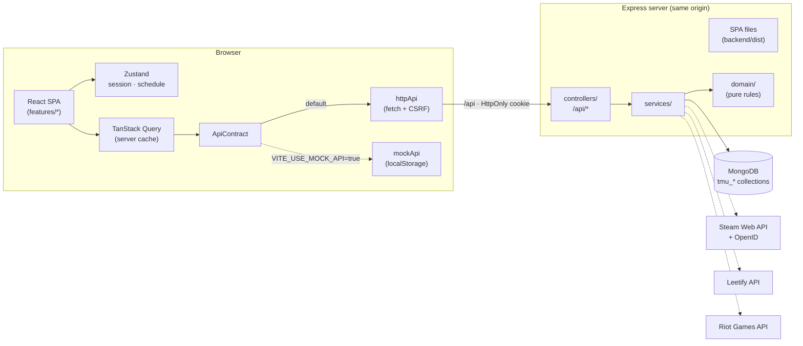

# TeamMatchUp

> Find someone to play with: same game, **similar competitive level** and **the same schedule**.


TeamMatchUp is a **full stack web application (SPA + REST API)** that matches players of
**League of Legends**, **Rainbow Six Siege** and **Counter-Strike 2**. It combines three
conditions that no existing tool solves together: two people play the same title, they have a
similar rank —taken from the game's own data source, not declared by the user— and they are
available in the same time blocks. The flow does not end in a list of profiles: it ends in a
**scheduled game session**.

Project for the course **CC5003 – Reactive Web Applications** (DCC, FCFM, Universidad de Chile).

**Deployed application:** https://fullstack.dcc.uchile.cl:7041/

> The user interface and the API error messages are in **Spanish**. This documentation is in
> English; UI labels are quoted as they appear on screen.

---

## Table of contents

1. [The problem and the proposal](#the-problem-and-the-proposal)
2. [Features](#features)
3. [Course requirements and where they are met](#course-requirements-and-where-they-are-met)
4. [Tech stack](#tech-stack)
5. [Architecture](#architecture)
6. [Repository structure](#repository-structure)
7. [Prerequisites](#prerequisites)
8. [Running locally](#running-locally)
9. [Environment variables](#environment-variables)
10. [Available scripts](#available-scripts)
11. [UI views and routes](#ui-views-and-routes)
12. [REST API](#rest-api)
13. [Data model](#data-model)
14. [Matching criteria](#matching-criteria)
15. [Global state](#global-state)
16. [Design and styling](#design-and-styling)
17. [External integrations (optional)](#external-integrations-optional)
18. [Testing](#testing)
19. [Production build](#production-build)
20. [Deployment on the course server](#deployment-on-the-course-server)
21. [Security](#security)
22. [Methodology](#methodology)
23. [Code conventions](#code-conventions)
24. [Troubleshooting](#troubleshooting)
25. [Additional documentation](#additional-documentation)
26. [Team](#team)

---

## The problem and the proposal

Players without a regular group end up playing with strangers assigned by automatic matchmaking:
no communication and large skill gaps within the team. The alternative coordination happens on
Discord, forums and messaging groups, where messages get lost, nobody verifies each player's real
level and nothing cross-references availability.

TeamMatchUp solves both halves at once:

- **Rank is fetched, not declared.** Verified accounts read their rank from the game's own source
  (Riot Games for LoL; Steam + Leetify for CS2). Each game's scale is normalized to 0–100 so that
  they can be compared.
- **An explicit weekly schedule grid** in one-hour blocks.
- **The cross-reference is the product**: every view shows rank and schedule together, and the
  list of compatible players leads straight to proposing and scheduling a session.
- **Nothing made up**: all simulated data is labeled "Datos de demostración" (demo data).

Details on users, purpose and product principles are in [`PRODUCT.md`](PRODUCT.md).

## Features

| Area | What it allows |
| --- | --- |
| **Account** | Sign up, log in and log out with own credentials; edit the profile (display name, color, bio, time zone); delete the account with cascading deletion. |
| **Game accounts** | Link a Riot ID (LoL), a Ubisoft ID (R6) or a SteamID64 (CS2) with its region. Each user links only the games they play. Resync and unlink. |
| **Verification** | CS2 by logging in to Steam (OpenID) and LoL by temporarily changing the summoner icon. Verified accounts show real data attributed to its source. |
| **Availability** | Weekly grid of one-hour blocks, painted by dragging the mouse. |
| **Profile** | Current rank, rank history, recent matches and win rate per game; switching games does not reload the page. |
| **Matches** | Recommended players per game, with filters for rank difference, shared hours, verified only and search by name. |
| **Player card** | Public profile of another player with "Proponer" (propose) a session in the shared hours. |
| **Schedule** | Weekly calendar: publish sessions (game, day, time, duration, slots), join, leave, edit (organizer) and cancel. |
| **Themes** | Light and dark theme with a minimum 4.5:1 contrast. |
| **Mock mode** | The whole interface works without a server, against a simulated backend in the browser. |

## Course requirements and where they are met

| Requirement | Implementation |
| --- | --- |
| **Global state** (Zustand or Redux, ≥ 2 stores) | Zustand 5: a **signed-in session** store and a **schedule** store (the main entity). See [Global state](#global-state). |
| **Routing** with public and protected routes; Back, Forward and F5 | React Router 6, `ProtectedRoute` + `SessionGate`, return to the original route after login; the server serves the SPA on any path outside `/api`. |
| **E2E tests** with Playwright in `e2etests/` (login + protected access, CRUD) | 7 scenarios: E1–E4 (authentication and protected routes) and C1–C3 (create, list, edit and cancel game sessions). See [E2E tests](#e2e-tests-e2etests). |
| **Styling library** | Mantine 8.3.18 with a theme built only from references to the design tokens. |
| **Best practices** | Strict TypeScript with no `any` or `@ts-ignore`; JSON errors `{ "error": "…" }` with their HTTP code; secrets only in `.env` (not versioned). |
| **Deployment** on `fullstack.dcc.uchile.cl` | Port 7041, PM2 process `reactivoActivo-7041`. |

## Tech stack

| Layer | Technology |
| --- | --- |
| UI | React 18, TypeScript, Vite 5, React Router 6 |
| Server data on the client | TanStack Query 5 (cache, no retries, per-user keys) |
| Global state | Zustand 5.0.16 (devtools in development only) |
| Styling | Mantine 8.3.18 (`@mantine/core`, `@mantine/hooks`), custom CSS tokens, Geist and Geist Mono fonts, Lucide icons, animations with Motion |
| Server | Node.js ≥ 22.18 (runs `.ts` directly in development), Express 5, ESM |
| Database | MongoDB with Mongoose 8 |
| Authentication | bcrypt, JWT in an `HttpOnly` cookie, anti‑CSRF token in a header |
| Testing | `node:test` + supertest (backend), Vitest (frontend), Playwright + Chromium (E2E) |
| Quality | ESLint 9 + typescript-eslint, `tsc` in strict mode |
| Production | PM2 on the course server; the backend serves the compiled SPA |

## Architecture



Decisions behind the design:

- **Pure, isolated domain.** The rules (rank scales, time blocks, matching engine, schedule rules,
  verification) live in `domain/` as pure functions, with no React, HTTP, Mongoose or clock:
  "now" is passed in as a parameter. On the backend, `tests/unit/domainIsolation.test.ts` enforces
  this.
- **A single data contract.** Components only talk to `services/api` (which fulfils
  `ApiContract`) and never call `fetch`. Behind it there are two interchangeable implementations:
  the real HTTP client and a simulated backend that answers with the same codes and texts as the
  server.
- **Same origin in production.** Express serves the compiled SPA and the API on the same port:
  there is no CORS and the cookie works with `SameSite=Strict`.
- **Injectable integrations.** Each external service has a single piece that holds the network
  access and the key (`steamClient`, `riotClient`, `leetifyClient`) with an injectable `fetch`, so
  no test touches the network.
- **One folder per feature** in the frontend and **lazy loading per route**: each view ships in
  its own bundle.
- **Game catalog as the single source of truth.** Selectors, tabs, filters and the schedule are
  generated from `domain/games.ts`.

## Repository structure

```
.
├── frontend/                 React + TypeScript SPA (Vite)
│   ├── src/
│   │   ├── app/              Composition, router, layouts, ProtectedRoute, SessionGate, StoreBridge
│   │   ├── config/           Environment variable reading
│   │   ├── domain/           Pure rules: types, games, rank, schedules, engine, schedule rules
│   │   ├── services/         ApiContract, HTTP client (http/), simulated backend (mock/), Data Dragon
│   │   ├── features/         auth · home · profile · matches · players · sessions · steam · riot
│   │   ├── shared/           Base components (on top of Mantine), hooks, animations, utilities
│   │   ├── theme/            Mantine theme made of references to the tokens
│   │   ├── styles/           tokens.css and global styles
│   │   └── assets/leetify/   Official "Data Provided by Leetify" logos
│   └── README.md             Views, architecture and API usage from the interface
├── backend/                  Express 5 + Mongoose + TypeScript API
│   ├── src/
│   │   ├── index.ts          Entry point: loads and validates the configuration
│   │   ├── server.ts         Connects to MongoDB, prepares indexes and listens
│   │   ├── app.ts            Express composition (routes, SPA, 404, errors)
│   │   ├── controllers/      users · auth · accounts · matches · sessions · steam · riot
│   │   ├── models/           user · gameAccount · playSession · steamAttempt · riotChallenge
│   │   ├── services/         Express-free logic: credentials, sessions, accounts, integrations
│   │   ├── domain/           Pure rules (no Express, Mongoose or clock)
│   │   └── utils/            config, errors, logger, clock, middleware
│   ├── tests/                unit/ · controllers/ (supertest) · server/ · fixtures/
│   ├── requests/             .rest files to try the API by hand
│   └── scripts/copyUi.ts     Copies the compiled interface to backend/dist
├── e2etests/                 Playwright E2E tests (standalone)
│   ├── tests/                Scenarios E1–E4 and C1–C3, fixtures, locators
│   ├── lib/                  Pure rules of the suite (with node:test)
│   ├── scripts/start-server.ts  Builds and starts the system under test
│   └── README.md             Full guide to the suite
└── PRODUCT.md                Users, purpose and product principles
```

## Prerequisites

| Tool | Version | Notes |
| --- | --- | --- |
| Node.js | **22.18 or later** | The backend runs `.ts` files directly in development and tests. On the course server Node 20 is enough, since the compiled JavaScript runs there. |
| npm | the one bundled with Node | The project's only package manager; every dependency is installed with `--save-exact`. |
| MongoDB | local, for example at `mongodb://127.0.0.1:27017` | Or with Docker: `docker run -d --name tmu-mongo -p 127.0.0.1:27017:27017 mongo`. |
| Playwright Chromium | — | Only for the E2E tests (`npm run browser:install` in `e2etests/`). |

## Running locally

### 1. Clone and install

```bash
git clone <repository-url> teammatchup
cd teammatchup
(cd backend && npm ci)
(cd frontend && npm ci)
```

### 2. Backend (port 3001)

```bash
cd backend
cp .env.example .env      # review the values; no external key is required
npm run dev               # node --watch src/index.ts
```

You should see `servidor escuchando en http://…:3001` ("server listening on"). If a variable is
missing or has an invalid value, the server does not start and lists the errors.

### 3. Frontend (port 5173)

In another terminal:

```bash
cd frontend
cp .env.example .env
npm run dev
```

Open http://localhost:5173 and create an account. Vite forwards `/api` to the backend
(`VITE_PROXY_TARGET`). The database starts empty: there is no preloaded data.

### Mock mode (no server)

To use the interface without a backend or MongoDB:

```bash
cd frontend
VITE_USE_MOCK_API=true npm run dev
# PowerShell: $env:VITE_USE_MOCK_API="true"; npm run dev
```

This enables a simulated backend in the browser with 16 fictional players, linked accounts, rank
history, availability and sessions. Demo account:

```
email:     demo@teammatchup.gg
password:  demo1234
```

Data is stored in `localStorage` (`tmu.mock-db.v3`); clearing the site storage restores the
initial state. Everything simulated is marked on screen with "Datos de demostración".

## Environment variables

### Backend (`backend/.env`)

Full template, with no secrets, in [`backend/.env.example`](backend/.env.example).

| Variable | Required | Description |
| --- | --- | --- |
| `NODE_ENV` | Yes | `development`, `test` or `production` |
| `PORT` | Yes | Listening port |
| `HOST` | No | Listening address; empty = all interfaces. On the course server, `0.0.0.0` |
| `MONGODB_URI` | Yes (except in `test`) | MongoDB location |
| `MONGODB_DBNAME` | Yes (except in `test`) | Database name |
| `TEST_MONGODB_URI` | Only in `test` | MongoDB location for the tests |
| `TEST_MONGODB_DBNAME` | Only in `test` | Test database; it cannot match the development one |
| `JWT_SECRET` | Yes | Session signing secret. The development value is rejected in production: generate one with `openssl rand -hex 32` |
| `STEAM_API_KEY` | No | Steam Web API key (enables "Verificar con Steam") |
| `PUBLIC_URL` | If `STEAM_API_KEY` is set | Address the browser uses to open the instance, no trailing slash; `https` in production |
| `RIOT_API_KEY` | No | Riot Games development key (enables "Verificar con Riot Games"; expires every 24 h) |
| `LEETIFY_API_KEY` | No | Leetify key; without it requests still work, with lower limits |

All collections carry the `tmu_` prefix in every environment, so they can coexist with other
groups in the course server's shared database.

### Frontend (`frontend/.env`)

| Variable | Default | Description |
| --- | --- | --- |
| `VITE_API_URL` | `/api` | API base address (relative; do not change it for production) |
| `VITE_USE_MOCK_API` | `false` | Exactly `true` enables the simulated backend; any other value uses the real server |
| `VITE_PROXY_TARGET` | `http://localhost:3001` | Target of Vite's `/api` proxy in development (must match the backend's `PORT`) |
| `VITE_MOCK_LATENCY` | — | Artificial latency (ms) of the simulated backend |

> No frontend value is a secret: everything that starts with `VITE_` ends up in the bundle the
> browser downloads.

## Available scripts

### `backend/`

| Script | What it does |
| --- | --- |
| `npm run dev` | Development server with reload (`node --watch src/index.ts`) |
| `npm test` | Tests with `node:test`, serial, `NODE_ENV=test` (needs MongoDB). On Windows: `npm test --script-shell=bash` |
| `npm run typecheck` | Types of the code and the tests |
| `npm run lint` | ESLint |
| `npm run build:ui` | Builds the interface and copies it to `backend/dist` |
| `npm run build` | Compiles the server into `backend/out` |
| `npm start` | Runs the compiled server (`node out/index.js`) |

### `frontend/`

| Script | What it does |
| --- | --- |
| `npm run dev` | Vite development server with hot reload |
| `npm run build` | Checks types and builds the production bundle in `dist/` |
| `npm run preview` | Serves the generated bundle |
| `npm run typecheck` | Checks types without emitting files |
| `npm run lint` | ESLint |
| `npm test` | Vitest: pure rules, store factories and the theme color check |

### `e2etests/`

| Script | What it does |
| --- | --- |
| `npm test` | Full E2E suite (builds, starts the server and runs the 7 scenarios) |
| `npm test -- --grep C2` | A single scenario |
| `npm run test:reverse` | The scenarios in reverse order (C3 → E1) |
| `npm run test:unit` | Tests of the suite's own rules |
| `npm run report` | Opens the HTML report of the last run |
| `npm run browser:install` | Downloads Chromium for Playwright |
| `npm run typecheck` · `npm run lint` | Types and lint of the suite |

## UI views and routes

| Route | View | Access |
| --- | --- | --- |
| `/` | Landing page | Public |
| `/login` · `/registro` | Login and sign up | Public |
| `/verificar/steam` | Return from Steam (completes CS2 verification) | Public |
| `/inicio` | Player summary on entry | Protected |
| `/perfil` | My profile: accounts, rank, history and matches per game | Protected |
| `/configuracion` | Profile, game accounts and availability grid | Protected |
| `/coincidencias` | Recommended players with filters | Protected |
| `/jugadores/:userId` | Another player's public card and "Proponer" | Protected |
| `/agenda` | Weekly calendar of game sessions | Protected |
| `/agenda/:sessionId` | Detail of a game session | Protected |
| `/verificar/riot` | LoL verification via summoner icon | Protected |

Visiting a protected route without a session goes through login and then returns to the original
route. Back, Forward and reload (F5) work in every view, also in production.

## REST API

All routes live under `/api`, return JSON and, unless marked public, require a session.
Runnable examples of every operation are in [`backend/requests/*.rest`](backend/requests)
(VS Code REST Client extension or equivalent).

### Authentication and CSRF

- `POST /api/auth/login` stores the session in the `token` cookie (`HttpOnly; SameSite=Strict`,
  plus `Secure` in production; lasts 1 hour) and returns an **anti‑CSRF token**.
- Protected operations read the credential **only** from the cookie and require the token in the
  `X-CSRF-Token` header. The `Authorization` header and the body are never inspected.
- The interface stores only the CSRF token (`tmu.csrf`), never a JWT.

### Operations

| Method | Route | Description |
| --- | --- | --- |
| `POST` | `/users` | Sign up (public; does not start a session) |
| `POST` | `/auth/login` | Log in (public) |
| `POST` | `/auth/logout` | Log out (public) |
| `GET` | `/auth/me` | User of the current session |
| `GET` | `/users` | List of users |
| `GET` | `/users/:id` | Public profile (`me` for your own) |
| `PATCH` | `/users/me` | Update your own profile |
| `DELETE` | `/users/me` | Delete the account and, in cascade, its game accounts, sessions and verification attempts |
| `GET` · `PUT` | `/users/:id/availability` | Read and replace (own only) the time blocks (`{ "blocks": string[] }`) |
| `GET` | `/users/:id/games/:gameId` | Account, rank, recent matches and win rate in a game |
| `GET` | `/accounts?user=me\|<id>` | A user's game accounts |
| `GET` | `/accounts/:id` | One game account |
| `POST` | `/accounts` | Link an account |
| `PUT` | `/accounts/:id` | Edit one of your accounts |
| `DELETE` | `/accounts/:id` | Unlink one of your accounts |
| `POST` | `/accounts/:id/sync` | Resync (real or simulated data depending on its origin) |
| `GET` | `/matches` | Matches (game, rank distance, shared hours, verified only, search) |
| `GET` · `POST` | `/sessions` | Game sessions (`?game=`) and publish one |
| `GET` · `PUT` | `/sessions/:id` | Detail and edit (organizer only) |
| `DELETE` | `/sessions/:id` | Cancel the session (organizer only) |
| `POST` | `/sessions/:id/join` · `/sessions/:id/leave` | Join or leave |
| `GET` | `/steam` | Whether Steam verification is available |
| `POST` | `/steam/start` · `/steam/complete` | Opens the attempt and completes it on return from Steam |
| `GET` | `/riot` | Whether Riot Games verification is available |
| `GET` | `/riot/challenges/current` | Open verification challenge |
| `POST` | `/riot/challenges` | Opens a challenge (icon to use, 10 minutes) |
| `POST` | `/riot/challenges/:id/confirm` | Confirms the icon change |

The exact response shapes are in
[`frontend/src/domain/types.ts`](frontend/src/domain/types.ts) and
[`frontend/src/services/apiContract.ts`](frontend/src/services/apiContract.ts).

### Errors

Every error responds `{ "error": "<message in Spanish>" }` with its HTTP code, with no traces or
internal data:

| Code | When |
| --- | --- |
| `400` | Failed validation, malformed identifier, email or username already used, full session, malformed JSON |
| `401` | No session, expired session, invalid token or missing CSRF token |
| `403` | Operation on a resource owned by someone else |
| `404` | Nonexistent resource or unknown API route (`endpoint desconocido`) |
| `409` | Verification conflict (account already verified, verified by another user or challenge in progress) |
| `413` · `415` | Body too large or unsupported encoding |
| `503` | External service unavailable (for example, an expired Riot key) |
| `500` | Internal error (`error interno del servidor`) |

## Data model

| Collection | Model | Contents |
| --- | --- | --- |
| `tmu_users` | `User` | Email, username, bcrypt hash, display name, color, bio, time zone and availability blocks |
| `tmu_gameaccounts` | `GameAccount` | Owner, game, identifier and region; current rank and normalized history (0–100); recent matches; origin (simulated or verified), verification data and source profile |
| `tmu_playsessions` | `PlaySession` | Game, organizer, title, notes, day (0–6), start hour (0–23), duration (1–4 h), slots (2–6), participants and status (`open`/`full`); with optimistic concurrency |
| `tmu_steamattempts` | `SteamAttempt` | Steam verification attempt: one per user, token hash, expires after 10 min (TTL index) |
| `tmu_riotchallenges` | `RiotChallenge` | Riot Games verification challenge: requested icon, 10-minute deadline, 24 h retention (TTL index) |

Supported games:

| Game | Identifier | Rank scale |
| --- | --- | --- |
| League of Legends | Riot ID (`Name#TAG`) | Iron → Challenger, divisions IV–I, LP |
| Rainbow Six Siege | Ubisoft ID | Copper → Champion, divisions V–I, MMR |
| Counter-Strike 2 | SteamID64 (`7656119…`) | Grey → Gold, CS Rating (Premier) |

## Matching criteria

Matches are computed by the server ([`backend/src/domain/matching.ts`](backend/src/domain/matching.ts))
by combining two components normalized to 0–100:

| Component | Weight | Rule |
| --- | --- | --- |
| Rank proximity | 0.55 | Each game translates its scale to 0–100; a difference of 25 points zeroes the component. |
| Schedule overlap | 0.45 | Shared weekly hours; 8 hours is considered an ideal overlap. |

Accounts without a rank are excluded (for example, unranked LoL or verified CS2 without a Premier
rating). Mock mode applies the same criteria in `frontend/src/domain/matching.ts`.

## Global state

There are two **Zustand** stores with distinct responsibilities. Server data stays in the
**TanStack Query** cache; the stores hold client state only.

| Store | Files | What it holds |
| --- | --- | --- |
| **Signed-in session** | `features/auth/createAuthStore.ts` (tested factory), `authStore.ts` | Status (`checking`, `authenticated`, `anonymous`, `error`), the session user and the error message. Operations: check session, retry, log in, sign up, log out and update the user. `useAuth()` is its facade. It never stores the CSRF token or passwords. |
| **Schedule** | `features/sessions/createAgendaStore.ts` (tested factory), `agendaStore.ts`, `domain/agendaRules.ts` | Schedule UI state: game filter, open session, form draft, pending "Proponer" proposal. It is preserved when leaving and returning to the schedule without reloading. |

`app/StoreBridge.tsx` connects the stores to the router, the 401 notice and the cache: on logout,
on session expiry or when switching accounts in another tab, both are reset leaving no trace of
the previous account. In development they can be inspected with Redux DevTools
("TeamMatchUp · sesión iniciada" and "TeamMatchUp · agenda"); in production the devtools are not
included.

## Design and styling

- **Mantine 8.3.18** as the component library. No view uses a bare Mantine component: it goes
  through an in-house component in `shared/components/` (`AppButton`, `IconButton`, `TextField`,
  `SelectField`, `SwitchField`, `SliderField`, `FilterChip`, `GameTabs`, `Slip` —modal window—,
  `Notice`, `Spinner`, `Stamp`…) that fixes classes, texts and accessible roles.
- **Design tokens** in `frontend/src/styles/tokens.css` as the single source of color, spacing and
  typography. The Mantine theme (`frontend/src/theme/`) is made only of references to those
  tokens; `npm test` fails if a hand-written color appears.
- **Light and dark theme**, chosen before painting by a script in the `<head>` (no flicker) and
  stored in `tmu.theme`. Contrast of at least 4.5:1 in both themes and keyboard operation.
- Interface in **Spanish**, designed for night-time use in front of the gaming monitor.

## External integrations (optional)

All are optional: without their keys the application works the same and the verification buttons
do not appear. Unverified accounts use **simulated, labeled** data; verified ones use real data
**attributed to its provider**. Keys go only in `backend/.env`, never in the repository.

### Steam — verify the CS2 account

The player logs in to Steam (OpenID) and returns to `/verificar/steam`. Real name, avatar,
country and CS2 hours are obtained.

```env
STEAM_API_KEY=<steam-web-api-key>
PUBLIC_URL=http://localhost:5173        # on the server: https://fullstack.dcc.uchile.cl:7041
```

`PUBLIC_URL` is the address Steam sends the user back to (no path or trailing slash). In
production it must be `https`.

### Leetify — CS2 Premier rating

A verified CS2 account gets its real Premier rating from Leetify's public API using its
SteamID64. It works without a key (with lower limits); a key raises the limits:

```env
LEETIFY_API_KEY=<key-generated-at-leetify.com/app/developer>
```

Following Leetify's guidelines, the "Data Provided by Leetify" logo is shown with "View on
Leetify", only the current rating is stored (no constructed history), and neither the position on
the game's scale nor the rank distance to another player is shown.

### Riot Games — verify the League of Legends account

The player temporarily changes their summoner icon to the one the application requests (10-minute
deadline). The real Solo/Duo rank, up to 20 recent Solo/Duo matches, level and summoner icon are
obtained. The server respects Riot's limits with its own rate limiter (20/s and 100/2 min) and a
per-user lock.

```env
RIOT_API_KEY=RGAPI-…
```

**Renewal every 24 hours.** Riot's development key expires after 24 hours. While it is expired,
verifying and resyncing LoL accounts respond `503` ("Riot Games no está disponible por ahora,
intenta más tarde") without logging the user out or losing data. To renew it:

1. Generate a new key on the [Riot Games developer portal](https://developer.riotgames.com/).
2. Replace `RIOT_API_KEY` in the `.env` (local or on the server).
3. Restart: locally, run `npm run dev` again in `backend/`; on the server,
   `pm2 restart reactivoActivo-7041`.

Open challenges that have not yet reached 10 minutes remain valid.

> Rainbow Six Siege has no real integration: its accounts always use simulated, labeled data.

## Testing

| Level | Tool | Where | How |
| --- | --- | --- | --- |
| Unit and API (backend) | `node:test` + supertest | `backend/tests/` | `cd backend && npm test` |
| Unit (frontend) | Vitest | `frontend/src/**/*.test.ts` | `cd frontend && npm test` |
| End to end | Playwright + Chromium | `e2etests/` | `cd e2etests && npm test` |

### Backend

Tests are written before the code (red → green) and cover the domain, every endpoint, delete
cascades with forced failures, concurrency, server startup and SPA serving in production. They use
the test database (`TEST_MONGODB_*`), never the development one, and none touches the network.

```bash
cd backend
npm test
npm run typecheck
npm run lint
```

### Frontend

Vitest in a node environment over the pure rules, the Zustand store factories and the check that
the theme has no hand-written colors.

```bash
cd frontend
npm test
npm run typecheck
npm run lint
```

### E2E tests (`e2etests/`)

The suite builds the interface and the server, starts the server in production mode at
`http://127.0.0.1:3901` with its own MongoDB database (`teammatchup_e2e`) and runs seven scenarios
in Chromium, serially and without retries:

| Code | Scenario |
| --- | --- |
| E1 | Protected route without a session and return to the original route |
| E2 | Wrong credentials |
| E3 | Protected route with a session and reload |
| E4 | Logout |
| C1 | Create and list a game session |
| C2 | View and edit, with Back, Forward and reload |
| C3 | Delete (cancel) a game session |

With a local MongoDB running, from the repository root:

```bash
(cd frontend && npm ci)
(cd backend && npm ci)
cd e2etests
npm ci
npm run browser:install   # first time only
npm test
```

- It does not need `backend/.env`: the suite sets its own variables and uses a random
  `JWT_SECRET` per run, with no external keys.
- Each scenario creates its own user through the API and deletes it when finished: after a full
  run the E2E database is left with no documents.
- Each run **replaces** `frontend/dist`, `backend/dist` and `backend/out`. Do not run it while a
  local production server from the same checkout is running.
- Optional variables: `E2E_PORT`, `E2E_MONGODB_URI`, `E2E_MONGODB_DBNAME`.

Full guide (prerequisites, reports, cleanup and limitations) in
[`e2etests/README.md`](e2etests/README.md).

## Production build

In production the backend also serves the compiled interface (same origin and port). From
`backend/`:

```bash
npm run build:ui    # builds the interface and copies it to backend/dist
npm run build       # compiles the server into backend/out
NODE_ENV=production JWT_SECRET=<own-secret> npm start
```

- With `NODE_ENV=production` the server serves the SPA on any path outside `/api` (reloading
  `/perfil` works) and a nonexistent API route responds `404` in JSON.
- If `backend/dist/index.html` is missing, the server does not start: it exits with code 1 and
  asks you to run `npm run build:ui`.
- The development `JWT_SECRET` is not accepted in production.
- `backend/.env` is also read from `backend/`, so the development database `teammatchup` is used.
  If that `.env` has `STEAM_API_KEY` with `PUBLIC_URL=http://…`, it will not start in production
  (it requires `https`): comment those lines out or pass `MONGODB_DBNAME` and `PUBLIC_URL` on the
  same command line.

## Deployment on the course server

| Item | Value |
| --- | --- |
| URL | https://fullstack.dcc.uchile.cl:7041/ |
| SSH | `ssh -p 219 <user>@fullstack.dcc.uchile.cl` (user shared by all groups) |
| Folder | `~/reactivoActivo` |
| PM2 process | `reactivoActivo-7041` |
| Database | `fullstack`, with the `tmu_` prefix on collections |

> **The server is shared.** Never use `pm2 restart all`, `pm2 stop all` or `pm2 delete all`, and
> do not touch other groups' folders or processes: always operate by the name
> `reactivoActivo-7041`.

The server **has no `rsync`**: upload with `tar` over `ssh`. Credentials never go in the
repository.

**1. Build** (on your machine, from `backend/`):

```bash
npm run build:ui && npm run build
```

**2. Upload** (from `backend/`; `node_modules` and the local `.env` are not uploaded):

```bash
COPYFILE_DISABLE=1 tar --no-xattrs -czf - --exclude node_modules --exclude .env --exclude tests --exclude requests --exclude .DS_Store . | ssh -p 219 <user>@fullstack.dcc.uchile.cl "mkdir -p ~/reactivoActivo && tar -xzf - -C ~/reactivoActivo"
```

**3. First time: create the production `.env`** (on the server):

```bash
cd ~/reactivoActivo && cat > .env <<EOF
NODE_ENV=production
PORT=7041
HOST=0.0.0.0
MONGODB_URI=<course-mongodb-uri>/?authSource=admin
MONGODB_DBNAME=fullstack
JWT_SECRET=$(node -e "console.log(require('crypto').randomBytes(32).toString('hex'))")
EOF
chmod 600 .env
```

The course's MongoDB user cannot create its own database (it answers `Unauthorized`, code 13);
that is why `fullstack` is used with the `tmu_` prefix. For the integrations, add
`STEAM_API_KEY`, `PUBLIC_URL=https://fullstack.dcc.uchile.cl:7041`, `RIOT_API_KEY` and
`LEETIFY_API_KEY` by hand to that `.env`, then `pm2 restart reactivoActivo-7041`.

**4. First time: install and start** (on the server):

```bash
cd ~/reactivoActivo && npm ci --omit=dev
pm2 start npm --name reactivoActivo-7041 -- run start
pm2 save
```

`npm` warns `EBADENGINE` because the server has Node 20; it does not matter, since the compiled
JavaScript runs there.

**5. Redeploy:** repeat steps 1 and 2 and then, on the server:

```bash
cd ~/reactivoActivo && npm ci --omit=dev && pm2 restart reactivoActivo-7041
```

**Verify:**

```bash
pm2 logs reactivoActivo-7041 --lines 30 --nostream
```

`servidor escuchando en http://0.0.0.0:7041` should appear. Then, in the browser: sign up, log in
(the cookie arrives with `HttpOnly; Secure; SameSite=Strict`), reload `/perfil` and log out. The
server has no demo data: matches are demonstrated with the team's real accounts.

| Action | Command |
| --- | --- |
| Status | `pm2 list` |
| Live logs | `pm2 logs reactivoActivo-7041` |
| Restart | `pm2 restart reactivoActivo-7041` |
| Stop | `pm2 stop reactivoActivo-7041` |

## Security

- Passwords with **bcrypt**; no response includes the hash or another user's email.
- **JWT only in an `HttpOnly` cookie** (`SameSite=Strict`, `Secure` in production) and a mandatory
  anti‑CSRF token in the `X-CSRF-Token` header.
- **Every write uses the session's user**, never an identifier sent by the client; the credential
  of a deleted user responds `401`.
- JSON bodies limited to 100 KiB; errors never expose internal messages or traces.
- Secrets only in `.env` (outside the repository, `chmod 600` on the server). The configuration is
  validated at startup and the server does not start with invalid values.
- No `dangerouslySetInnerHTML` in the interface.
- `.env`, `dist/` and `out/` are never committed.

## Methodology

The project is developed with **Spec-Driven Development (SDD)**: every change starts from a
written, approved requirement before any code is touched, and is validated against that
requirement. Working documents (specs, plans and tasks) are kept outside the repository.

## Code conventions

- **Language:** identifiers and file names in English; code comments, error messages and the
  interface in Spanish.
- **Strict TypeScript:** no `any`, no `@ts-ignore`.
- **Dependencies** with an exact version (`npm install --save-exact`) and only if an approved spec
  justifies them.
- **Styles** only from `styles/tokens.css`; no hand-written colors.
- **Tests first** in the backend and in the frontend rules that a spec requires testing. No task
  is closed with tests, typecheck or lint failing, or with an `.only` in the code.
- **Commits** in Conventional Commits style with the spec as scope, for example
  `feat(spec-018): …`, `fix(spec-013): …`, `docs(spec-010): …`.

## Troubleshooting

| Symptom | Cause and solution |
| --- | --- |
| The backend does not start and lists variables | A `backend/.env` variable is missing or invalid; compare it with `.env.example`. |
| `no se pudieron preparar los índices de la base de datos` | `MONGODB_DBNAME` points to a database without permissions; on the course server use `fullstack`. |
| The interface shows network errors in development | The backend is not running or `VITE_PROXY_TARGET` does not match `PORT`. |
| In production it does not start: `dist/index.html` missing | Run `npm run build:ui` in `backend/` before `npm start`. |
| In production it does not start because of `PUBLIC_URL` | With `STEAM_API_KEY`, `PUBLIC_URL` must be `https`; comment those lines out locally. |
| Verifying or resyncing LoL responds `503` | `RIOT_API_KEY` expired (24 h); renew it and restart the process. |
| "Verificar con Steam" or "con Riot Games" does not appear | The instance has no `STEAM_API_KEY` or `RIOT_API_KEY`; this is the expected behavior. |
| Backend `npm test` fails on Windows | Use `npm test --script-shell=bash`. |
| The E2E suite fails before building | Missing local MongoDB, dependencies or Chromium, or port 3901 is busy; the message says which. |
| Mock mode is in a strange state | Clear the site storage (`tmu.mock-db.v3`) to return to the initial state. |

## Additional documentation

| Document | Contents |
| --- | --- |
| [`PRODUCT.md`](PRODUCT.md) | Users, purpose, positioning and product principles |
| [`frontend/README.md`](frontend/README.md) | Views, interface architecture and API usage |
| [`e2etests/README.md`](e2etests/README.md) | Full guide to the E2E tests |

## Team

Constanza Torres · Daniel Ayala · Sebastián Valenzuela · Benjamín Estupiñán ·
Marcelo Zamorano · Vicente Oliva

CC5003 – Reactive Web Applications · Department of Computer Science · Universidad de Chile.
