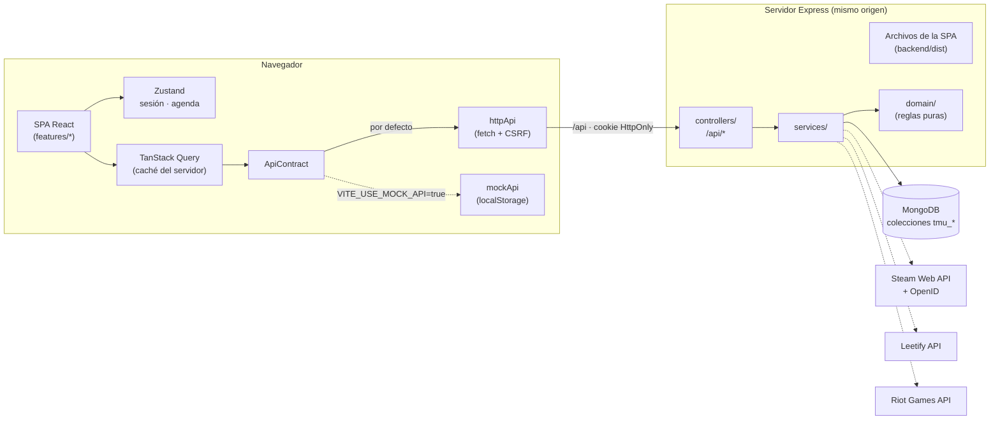

# TeamMatchUp

> Encuentra con quién jugar: mismo juego, **nivel competitivo similar** y **los mismos horarios**.


TeamMatchUp es una **aplicación web full stack (SPA + API REST)** que empareja jugadores de
**League of Legends**, **Rainbow Six Siege** y **Counter-Strike 2**. Cruza tres condiciones que
hoy ninguna herramienta resuelve junta: que dos personas jueguen el mismo título, que tengan un
rango similar —obtenido de la fuente del juego, no declarado por el usuario— y que estén
disponibles en los mismos bloques horarios. El flujo no termina en una lista de perfiles: termina
en una **sesión de juego agendada**.

Proyecto del curso **CC5003 – Aplicaciones Web Reactivas** (DCC, FCFM, Universidad de Chile).

**Aplicación desplegada:** https://fullstack.dcc.uchile.cl:7041/

---

## Tabla de contenidos

1. [El problema y la propuesta](#el-problema-y-la-propuesta)
2. [Funcionalidades](#funcionalidades)
3. [Requisitos del hito y dónde se cumplen](#requisitos-del-hito-y-dónde-se-cumplen)
4. [Stack tecnológico](#stack-tecnológico)
5. [Arquitectura](#arquitectura)
6. [Estructura del repositorio](#estructura-del-repositorio)
7. [Requisitos previos](#requisitos-previos)
8. [Puesta en marcha en local](#puesta-en-marcha-en-local)
9. [Variables de entorno](#variables-de-entorno)
10. [Scripts disponibles](#scripts-disponibles)
11. [Vistas y rutas de la interfaz](#vistas-y-rutas-de-la-interfaz)
12. [API REST](#api-rest)
13. [Modelo de datos](#modelo-de-datos)
14. [Criterio de emparejamiento](#criterio-de-emparejamiento)
15. [Estado global](#estado-global)
16. [Diseño y estilos](#diseño-y-estilos)
17. [Integraciones externas (opcionales)](#integraciones-externas-opcionales)
18. [Pruebas](#pruebas)
19. [Construcción de producción](#construcción-de-producción)
20. [Despliegue en el servidor del curso](#despliegue-en-el-servidor-del-curso)
21. [Seguridad](#seguridad)
22. [Metodología](#metodología)
23. [Convenciones de código](#convenciones-de-código)
24. [Solución de problemas](#solución-de-problemas)
25. [Documentación adicional](#documentación-adicional)
26. [Equipo](#equipo)

---

## El problema y la propuesta

Los jugadores sin grupo fijo terminan jugando con desconocidos que asigna el emparejamiento automático: sin comunicación y con diferencias grandes de nivel dentro del equipo. La coordinación
alternativa ocurre en Discord, foros y grupos de mensajería, donde los mensajes se pierden, nadie verifica el nivel real de cada jugador y nada cruza la disponibilidad horaria.

TeamMatchUp resuelve las dos mitades a la vez:

- **El rango se obtiene, no se declara.** Las cuentas verificadas leen su rango de la fuente del
  juego (Riot Games para LoL; Steam + Leetify para CS2). Las escalas de cada juego se normalizan a
  0–100 para poder compararlas.
- **Grilla horaria semanal explícita** por bloques de una hora.
- **El cruce es el producto**: toda vista muestra rango y horario juntos, y la lista de
  compatibles lleva directo a proponer y agendar una sesión.
- **Nada inventado**: todo dato simulado se muestra etiquetado como «Datos de demostración».

El detalle de usuarios, propósito y principios de producto está en [`PRODUCT.md`](PRODUCT.md).

## Funcionalidades

| Área | Qué permite |
| --- | --- |
| **Cuenta** | Registro, inicio y cierre de sesión con credenciales propias; edición de la ficha (nombre visible, color, biografía, zona horaria); eliminación de la cuenta con borrado en cascada. |
| **Cuentas de juego** | Vincular un Riot ID (LoL), un Ubisoft ID (R6) o un SteamID64 (CS2) con su región. Cada usuario vincula solo los juegos que juega. Resincronizar y desvincular. |
| **Verificación** | CS2 iniciando sesión en Steam (OpenID) y LoL cambiando temporalmente el ícono de invocador. Las cuentas verificadas muestran datos reales atribuidos a su fuente. |
| **Disponibilidad** | Grilla semanal de bloques de una hora que se pinta arrastrando el mouse. |
| **Perfil** | Rango vigente, evolución del rango, últimas partidas y tasa de victorias por juego; el cambio entre juegos no recarga la página. |
| **Coincidencias** | Jugadores recomendados por juego con filtros de diferencia de rango, horas en común, solo verificados y búsqueda por nombre. |
| **Ficha de jugador** | Perfil público de otro jugador con «Proponer» una sesión en las horas en común. |
| **Agenda** | Calendario semanal: publicar sesiones (juego, día, hora, duración, cupos), sumarse, salir, editar (quien organiza) y cancelar. |
| **Temas** | Tema claro y oscuro con contraste mínimo de 4,5:1. |
| **Modo simulado** | Toda la interfaz funciona sin servidor, contra un backend simulado en el navegador. |

## Requisitos del hito y dónde se cumplen

| Requisito del enunciado | Implementación |
| --- | --- |
| **Estado global** (Zustand o Redux, ≥ 2 stores) | Zustand 5: almacén de la **sesión iniciada** y almacén de la **agenda** (entidad principal). Ver [Estado global](#estado-global). |
| **Ruteo** con rutas públicas y protegidas; Atrás, Adelante y F5 | React Router 6, `ProtectedRoute` + `SessionGate`, vuelta a la ruta de origen tras iniciar sesión; el servidor entrega la SPA en cualquier ruta fuera de `/api`. |
| **Pruebas E2E** con Playwright en `e2etests/` (login + acceso protegido, CRUD) | 7 escenarios: E1–E4 (autenticación y rutas protegidas) y C1–C3 (crear, listar, editar y cancelar sesiones de juego). Ver [Pruebas E2E](#pruebas-e2e-e2etests). |
| **Librería de estilos** | Mantine 8.3.18 con un tema construido solo con referencias a los tokens de diseño. |
| **Buenas prácticas** | TypeScript estricto sin `any` ni `@ts-ignore`; errores en JSON `{ "error": "…" }` con su código HTTP; secretos solo en `.env` (no versionado). |
| **Despliegue** en `fullstack.dcc.uchile.cl` | Puerto 7041, proceso PM2 `reactivoActivo-7041`. |

## Stack tecnológico

| Capa | Tecnología |
| --- | --- |
| Interfaz | React 18, TypeScript, Vite 5, React Router 6 |
| Datos del servidor en el cliente | TanStack Query 5 (caché, sin reintentos, claves por usuario) |
| Estado global | Zustand 5.0.16 (con devtools solo en desarrollo) |
| Estilos | Mantine 8.3.18 (`@mantine/core`, `@mantine/hooks`), tokens CSS propios, fuentes Geist y Geist Mono, íconos Lucide, animaciones con Motion |
| Servidor | Node.js ≥ 22.18 (ejecuta `.ts` directo en desarrollo), Express 5, ESM |
| Base de datos | MongoDB con Mongoose 8 |
| Autenticación | bcrypt, JWT en cookie `HttpOnly`, comprobante anti‑CSRF en cabecera |
| Pruebas | `node:test` + supertest (backend), Vitest (frontend), Playwright + Chromium (E2E) |
| Calidad | ESLint 9 + typescript-eslint, `tsc` en modo estricto |
| Producción | PM2 en el servidor del curso; el backend sirve la SPA compilada |

## Arquitectura



Decisiones que sostienen el diseño:

- **Dominio puro y aislado.** Las reglas (escalas de rango, bloques horarios, motor de
  coincidencias, reglas de la agenda, verificación) viven en `domain/` como funciones puras, sin
  React, HTTP, Mongoose ni reloj: «ahora» llega como parámetro. En el backend lo vigila
  `tests/unit/domainIsolation.test.ts`.
- **Un solo contrato de datos.** Los componentes solo hablan con `services/api` (que cumple
  `ApiContract`) y nunca llaman a `fetch`. Detrás hay dos implementaciones intercambiables: el
  cliente HTTP real y un backend simulado que responde con los mismos códigos y textos que el
  servidor.
- **Mismo origen en producción.** Express sirve la SPA compilada y la API en el mismo puerto: no
  hay CORS y la cookie funciona con `SameSite=Strict`.
- **Integraciones inyectables.** Cada servicio externo tiene una única pieza con red y con la
  clave (`steamClient`, `riotClient`, `leetifyClient`) con `fetch` inyectable, así que ninguna
  prueba toca la red.
- **Una carpeta por funcionalidad** en el frontend y **carga diferida por ruta**: cada vista viaja
  en su propio paquete.
- **Catálogo de juegos como fuente única.** Selectores, pestañas, filtros y agenda se generan desde
  `domain/games.ts`.

## Estructura del repositorio

```
.
├── frontend/                 SPA React + TypeScript (Vite)
│   ├── src/
│   │   ├── app/              Composición, router, layouts, ProtectedRoute, SessionGate, StoreBridge
│   │   ├── config/           Lectura de variables de entorno
│   │   ├── domain/           Reglas puras: tipos, juegos, rango, horarios, motor, reglas de agenda
│   │   ├── services/         ApiContract, cliente HTTP (http/), backend simulado (mock/), Data Dragon
│   │   ├── features/         auth · home · profile · matches · players · sessions · steam · riot
│   │   ├── shared/           Componentes base (sobre Mantine), hooks, animaciones, utilidades
│   │   ├── theme/            Tema de Mantine hecho de referencias a los tokens
│   │   ├── styles/           tokens.css y estilos globales
│   │   └── assets/leetify/   Logos oficiales «Data Provided by Leetify»
│   └── README.md             Detalle de vistas, arquitectura y API desde la interfaz
├── backend/                  API Express 5 + Mongoose + TypeScript
│   ├── src/
│   │   ├── index.ts          Entrada: carga y valida la configuración
│   │   ├── server.ts         Conecta a MongoDB, prepara índices y escucha
│   │   ├── app.ts            Composición de Express (rutas, SPA, 404, errores)
│   │   ├── controllers/      users · auth · accounts · matches · sessions · steam · riot
│   │   ├── models/           user · gameAccount · playSession · steamAttempt · riotChallenge
│   │   ├── services/         Lógica sin Express: credenciales, sesiones, cuentas, integraciones
│   │   ├── domain/           Reglas puras (sin Express, Mongoose ni reloj)
│   │   └── utils/            config, errores, logger, reloj, middleware
│   ├── tests/                unit/ · controllers/ (supertest) · server/ · fixtures/
│   ├── requests/             Archivos .rest para probar la API a mano
│   └── scripts/copyUi.ts     Copia la interfaz compilada a backend/dist
├── e2etests/                 Pruebas E2E con Playwright (independiente)
│   ├── tests/                Escenarios E1–E4 y C1–C3, fixtures, localizadores
│   ├── lib/                  Reglas puras de la suite (con node:test)
│   ├── scripts/start-server.ts  Compila y arranca el sistema bajo prueba
│   └── README.md             Guía completa de la suite
└── PRODUCT.md                Usuarios, propósito y principios de producto
```

## Requisitos previos

| Herramienta | Versión | Notas |
| --- | --- | --- |
| Node.js | **22.18 o superior** | El backend ejecuta los `.ts` directamente en desarrollo y pruebas. En el servidor del curso basta Node 20, porque ahí corre el JavaScript compilado. |
| npm | el incluido con Node | Gestor único del proyecto; toda dependencia se instala con `--save-exact`. |
| MongoDB | local, por ejemplo en `mongodb://127.0.0.1:27017` | O con Docker: `docker run -d --name tmu-mongo -p 127.0.0.1:27017:27017 mongo`. |
| Chromium de Playwright | — | Solo para las pruebas E2E (`npm run browser:install` en `e2etests/`). |

## Puesta en marcha en local

### 1. Clonar e instalar

```bash
git clone <url-del-repositorio> teammatchup
cd teammatchup
(cd backend && npm ci)
(cd frontend && npm ci)
```

### 2. Backend (puerto 3001)

```bash
cd backend
cp .env.example .env      # revisa los valores; no hace falta ninguna clave externa
npm run dev               # node --watch src/index.ts
```

Debe aparecer `servidor escuchando en http://…:3001`. Si falta una variable o tiene un valor
inválido, el servidor no arranca y lista los errores.

### 3. Frontend (puerto 5173)

En otra terminal:

```bash
cd frontend
cp .env.example .env
npm run dev
```

Abre http://localhost:5173 y crea una cuenta. Vite reenvía `/api` al backend
(`VITE_PROXY_TARGET`). La base empieza vacía: no hay datos precargados.

### Modo simulado (sin servidor)

Para usar la interfaz sin backend ni MongoDB:

```bash
cd frontend
VITE_USE_MOCK_API=true npm run dev
# PowerShell: $env:VITE_USE_MOCK_API="true"; npm run dev
```

Se activa un backend simulado en el navegador con 16 jugadores ficticios, cuentas vinculadas,
historial de rango, disponibilidades y sesiones. Cuenta de demostración:

```
correo:      demo@teammatchup.gg
contraseña:  demo1234
```

Los datos se guardan en `localStorage` (`tmu.mock-db.v3`); borrar el almacenamiento del sitio
los devuelve al estado inicial. Todo lo simulado se marca en pantalla con «Datos de demostración».

## Variables de entorno

### Backend (`backend/.env`)

Plantilla completa y sin secretos en [`backend/.env.example`](backend/.env.example).

| Variable | Obligatoria | Descripción |
| --- | --- | --- |
| `NODE_ENV` | Sí | `development`, `test` o `production` |
| `PORT` | Sí | Puerto de escucha |
| `HOST` | No | Dirección de escucha; vacía = todas las interfaces. En el servidor del curso, `0.0.0.0` |
| `MONGODB_URI` | Sí (salvo en `test`) | Ubicación de MongoDB |
| `MONGODB_DBNAME` | Sí (salvo en `test`) | Nombre de la base |
| `TEST_MONGODB_URI` | Solo en `test` | Ubicación de MongoDB para las pruebas |
| `TEST_MONGODB_DBNAME` | Solo en `test` | Base de prueba; no puede coincidir con la de desarrollo |
| `JWT_SECRET` | Sí | Secreto de firma de la sesión. En producción no se admite el valor de desarrollo: genera uno con `openssl rand -hex 32` |
| `STEAM_API_KEY` | No | Clave de la API web de Steam (habilita «Verificar con Steam») |
| `PUBLIC_URL` | Si hay `STEAM_API_KEY` | Dirección con que el navegador abre la instancia, sin barra final; `https` en producción |
| `RIOT_API_KEY` | No | Clave de desarrollo de Riot Games (habilita «Verificar con Riot Games»; caduca cada 24 h) |
| `LEETIFY_API_KEY` | No | Clave de Leetify; sin ella se consulta igual, con límites más bajos |

Todas las colecciones llevan el prefijo `tmu_` en todos los entornos, para convivir con otros
grupos en la base compartida del servidor del curso.

### Frontend (`frontend/.env`)

| Variable | Por defecto | Descripción |
| --- | --- | --- |
| `VITE_API_URL` | `/api` | Dirección base de la API (relativa; no cambiarla para producción) |
| `VITE_USE_MOCK_API` | `false` | Exactamente `true` activa el backend simulado; cualquier otro valor usa el servidor real |
| `VITE_PROXY_TARGET` | `http://localhost:3001` | Destino del proxy `/api` de Vite en desarrollo (debe coincidir con `PORT` del backend) |
| `VITE_MOCK_LATENCY` | — | Latencia artificial (ms) del backend simulado |

> Ningún valor del frontend es un secreto: todo lo que empieza con `VITE_` termina en el paquete
> que descarga el navegador.

## Scripts disponibles

### `backend/`

| Script | Qué hace |
| --- | --- |
| `npm run dev` | Servidor de desarrollo con recarga (`node --watch src/index.ts`) |
| `npm test` | Pruebas con `node:test` en serie y `NODE_ENV=test` (necesita MongoDB). En Windows: `npm test --script-shell=bash` |
| `npm run typecheck` | Tipos del código y de las pruebas |
| `npm run lint` | ESLint |
| `npm run build:ui` | Compila la interfaz y la copia a `backend/dist` |
| `npm run build` | Compila el servidor en `backend/out` |
| `npm start` | Ejecuta el servidor compilado (`node out/index.js`) |

### `frontend/`

| Script | Qué hace |
| --- | --- |
| `npm run dev` | Servidor de desarrollo de Vite con recarga en caliente |
| `npm run build` | Comprueba tipos y genera el paquete de producción en `dist/` |
| `npm run preview` | Sirve el paquete generado |
| `npm run typecheck` | Verifica tipos sin emitir archivos |
| `npm run lint` | ESLint |
| `npm test` | Vitest: reglas puras, fábricas de los almacenes y comprobación de colores del tema |

### `e2etests/`

| Script | Qué hace |
| --- | --- |
| `npm test` | Suite E2E completa (compila, arranca el servidor y recorre los 7 escenarios) |
| `npm test -- --grep C2` | Un solo escenario |
| `npm run test:reverse` | Los escenarios en orden inverso (C3 → E1) |
| `npm run test:unit` | Pruebas de las reglas propias de la suite |
| `npm run report` | Abre el informe HTML de la última ejecución |
| `npm run browser:install` | Descarga Chromium para Playwright |
| `npm run typecheck` · `npm run lint` | Tipos y lint de la suite |

## Vistas y rutas de la interfaz

| Ruta | Vista | Acceso |
| --- | --- | --- |
| `/` | Portada | Pública |
| `/login` · `/registro` | Inicio de sesión y registro | Pública |
| `/verificar/steam` | Vuelta de Steam (completa la verificación de CS2) | Pública |
| `/inicio` | Resumen del jugador al entrar | Protegida |
| `/perfil` | Mi ficha: cuentas, rango, evolución y partidas por juego | Protegida |
| `/configuracion` | Ficha, cuentas de juego y grilla de disponibilidad | Protegida |
| `/coincidencias` | Jugadores recomendados con filtros | Protegida |
| `/jugadores/:userId` | Ficha pública de otro jugador y «Proponer» | Protegida |
| `/agenda` | Calendario semanal de sesiones de juego | Protegida |
| `/agenda/:sessionId` | Detalle de una sesión de juego | Protegida |
| `/verificar/riot` | Verificación de LoL por ícono de invocador | Protegida |

Al entrar sin sesión a una ruta protegida se pasa por el inicio de sesión y luego se vuelve a la
ruta de origen. Atrás, Adelante y la recarga (F5) funcionan en todas las vistas, también en
producción.

## API REST

Todas las rutas van bajo `/api`, responden JSON y, salvo las marcadas como públicas, exigen
sesión. Hay ejemplos ejecutables de cada operación en [`backend/requests/*.rest`](backend/requests)
(extensión REST Client de VS Code o equivalente).

### Autenticación y CSRF

- `POST /api/auth/login` deja la sesión en la cookie `token` (`HttpOnly; SameSite=Strict`, y
  `Secure` en producción; dura 1 hora) y devuelve un **comprobante anti‑CSRF**.
- Las operaciones protegidas leen la credencial **solo** de la cookie y exigen el comprobante en la
  cabecera `X-CSRF-Token`. La cabecera `Authorization` y el cuerpo no se miran nunca.
- La interfaz guarda únicamente el comprobante CSRF (`tmu.csrf`), nunca un JWT.

### Operaciones

| Método | Ruta | Descripción |
| --- | --- | --- |
| `POST` | `/users` | Registro (pública; no abre sesión) |
| `POST` | `/auth/login` | Inicia sesión (pública) |
| `POST` | `/auth/logout` | Cierra sesión (pública) |
| `GET` | `/auth/me` | Usuario de la sesión actual |
| `GET` | `/users` | Lista de usuarios |
| `GET` | `/users/:id` | Ficha pública (`me` para la propia) |
| `PATCH` | `/users/me` | Actualiza la ficha propia |
| `DELETE` | `/users/me` | Elimina la cuenta y, en cascada, sus cuentas de juego, sesiones e intentos de verificación |
| `GET` · `PUT` | `/users/:id/availability` | Lee y reemplaza (solo la propia) los bloques horarios (`{ "blocks": string[] }`) |
| `GET` | `/users/:id/games/:gameId` | Cuenta, rango, partidas recientes y tasa de victorias en un juego |
| `GET` | `/accounts?user=me\|<id>` | Cuentas de juego de un usuario |
| `GET` | `/accounts/:id` | Una cuenta de juego |
| `POST` | `/accounts` | Vincula una cuenta |
| `PUT` | `/accounts/:id` | Edita una cuenta propia |
| `DELETE` | `/accounts/:id` | Desvincula una cuenta propia |
| `POST` | `/accounts/:id/sync` | Resincroniza (datos reales o simulados según su origen) |
| `GET` | `/matches` | Coincidencias (juego, distancia de rango, horas en común, solo verificadas, búsqueda) |
| `GET` · `POST` | `/sessions` | Sesiones de juego (`?game=`) y publicar una |
| `GET` · `PUT` | `/sessions/:id` | Detalle y edición (solo quien organiza) |
| `DELETE` | `/sessions/:id` | Cancela la sesión (solo quien organiza) |
| `POST` | `/sessions/:id/join` · `/sessions/:id/leave` | Sumarse o salir |
| `GET` | `/steam` | Si la verificación con Steam está disponible |
| `POST` | `/steam/start` · `/steam/complete` | Abre el intento y lo completa al volver de Steam |
| `GET` | `/riot` | Si la verificación con Riot Games está disponible |
| `GET` | `/riot/challenges/current` | Desafío de verificación abierto |
| `POST` | `/riot/challenges` | Abre un desafío (ícono a usar, 10 minutos) |
| `POST` | `/riot/challenges/:id/confirm` | Confirma el cambio de ícono |

Las formas exactas de las respuestas están en
[`frontend/src/domain/types.ts`](frontend/src/domain/types.ts) y
[`frontend/src/services/apiContract.ts`](frontend/src/services/apiContract.ts).

### Errores

Todo error responde `{ "error": "<mensaje en español>" }` con su código HTTP, sin trazas ni datos
internos:

| Código | Cuándo |
| --- | --- |
| `400` | Validación fallida, identificador mal formado, correo o nombre ya usado, sesión llena, JSON mal formado |
| `401` | Sin sesión, sesión vencida, token inválido o falta el comprobante CSRF |
| `403` | Operación sobre un recurso ajeno |
| `404` | Recurso inexistente o ruta de API desconocida (`endpoint desconocido`) |
| `409` | Conflicto de verificación (cuenta ya verificada, verificada por otro usuario o desafío en curso) |
| `413` · `415` | Cuerpo demasiado grande o codificación no soportada |
| `503` | Servicio externo no disponible (por ejemplo, la clave de Riot caducada) |
| `500` | Error interno (`error interno del servidor`) |

## Modelo de datos

| Colección | Modelo | Contenido |
| --- | --- | --- |
| `tmu_users` | `User` | Correo, nombre de usuario, hash bcrypt, nombre visible, color, biografía, zona horaria y bloques de disponibilidad |
| `tmu_gameaccounts` | `GameAccount` | Dueño, juego, identificador y región; rango vigente e historial normalizado (0–100); partidas recientes; origen (simulado o verificado), datos de verificación y perfil de la fuente |
| `tmu_playsessions` | `PlaySession` | Juego, organizador, título, notas, día (0–6), hora de inicio (0–23), duración (1–4 h), cupos (2–6), participantes y estado (`open`/`full`); con concurrencia optimista |
| `tmu_steamattempts` | `SteamAttempt` | Intento de verificación con Steam: uno por usuario, hash del token, vence a los 10 min (índice TTL) |
| `tmu_riotchallenges` | `RiotChallenge` | Desafío de verificación con Riot Games: ícono pedido, plazo de 10 min, retención de 24 h (índice TTL) |

Juegos soportados:

| Juego | Identificador | Escala de rango |
| --- | --- | --- |
| League of Legends | Riot ID (`Nombre#TAG`) | Iron → Challenger, divisiones IV–I, LP |
| Rainbow Six Siege | Ubisoft ID | Copper → Champion, divisiones V–I, MMR |
| Counter-Strike 2 | SteamID64 (`7656119…`) | Grey → Gold, CS Rating (Premier) |

## Criterio de emparejamiento

Las coincidencias las calcula el servidor ([`backend/src/domain/matching.ts`](backend/src/domain/matching.ts))
combinando dos componentes normalizados a 0–100:

| Componente | Peso | Regla |
| --- | --- | --- |
| Cercanía de rango | 0,55 | Cada juego traduce su escala a 0–100; una diferencia de 25 puntos anula el componente. |
| Traslape horario | 0,45 | Horas semanales en común; 8 horas se consideran un traslape ideal. |

Quedan fuera las cuentas sin rango (por ejemplo, LoL sin clasificar o CS2 verificada sin rango
Premier). El modo simulado aplica el mismo criterio en `frontend/src/domain/matching.ts`.

## Estado global

Hay dos almacenes de **Zustand** con responsabilidades distintas (spec 016). Los datos del servidor
siguen en la caché de **TanStack Query**; los almacenes guardan solo estado de cliente.

| Almacén | Archivos | Qué guarda |
| --- | --- | --- |
| **Sesión iniciada** | `features/auth/createAuthStore.ts` (fábrica probada), `authStore.ts` | Estado (`checking`, `authenticated`, `anonymous`, `error`), usuario de la sesión y mensaje de error. Operaciones: consultar sesión, reintentar, iniciar sesión, registrarse, cerrar sesión y actualizar el usuario. `useAuth()` es su fachada. Nunca guarda el comprobante CSRF ni contraseñas. |
| **Agenda** | `features/sessions/createAgendaStore.ts` (fábrica probada), `agendaStore.ts`, `domain/agendaRules.ts` | Estado de interfaz de la agenda: filtro por juego, sesión abierta, borrador del formulario, propuesta pendiente de «Proponer». Se conserva al salir y volver a la agenda sin recargar. |

`app/StoreBridge.tsx` conecta los almacenes con el router, el aviso de 401 y la caché: al cerrar
sesión, al vencer la sesión o al cambiar de cuenta en otra pestaña, ambos se reinician sin dejar
rastro de la cuenta anterior. En desarrollo se inspeccionan con Redux DevTools
(«TeamMatchUp · sesión iniciada» y «TeamMatchUp · agenda»); en producción las devtools no se
incluyen.

## Diseño y estilos

- **Mantine 8.3.18** como librería de componentes (spec 017). Ninguna vista usa un componente de
  Mantine suelto: pasa por un componente propio de `shared/components/` (`AppButton`, `IconButton`,
  `TextField`, `SelectField`, `SwitchField`, `SliderField`, `FilterChip`, `GameTabs`, `Slip`
  —ventana modal—, `Notice`, `Spinner`, `Stamp`…) que fija clases, textos y roles accesibles.
- **Tokens de diseño** en `frontend/src/styles/tokens.css` como única fuente de color, espacio y
  tipografía. El tema de Mantine (`frontend/src/theme/`) está hecho solo de referencias a esos
  tokens; `npm test` falla si aparece un color escrito a mano.
- **Tema claro y oscuro**, elegido antes de pintar por un script del `<head>` (sin parpadeo) y
  guardado en `tmu.theme`. Contraste de al menos 4,5:1 en ambos temas y operación por teclado.
- Interfaz en **español**, pensada para uso nocturno frente al monitor de juego.

## Integraciones externas (opcionales)

Todas son opcionales: sin sus claves la aplicación funciona igual y los botones de verificación no
aparecen. Las cuentas sin verificar usan datos **simulados y etiquetados**; las verificadas usan
datos reales **atribuidos a quien los entrega**. Las claves van solo en `backend/.env`, nunca en
el repositorio.

### Steam — verificar la cuenta de CS2

El jugador inicia sesión en Steam (OpenID) y vuelve a `/verificar/steam`. Se obtienen nombre,
avatar, país y horas de CS2 reales.

```env
STEAM_API_KEY=<clave-de-la-api-web-de-steam>
PUBLIC_URL=http://localhost:5173        # en el servidor: https://fullstack.dcc.uchile.cl:7041
```

`PUBLIC_URL` es la dirección a la que Steam devuelve al usuario (sin ruta ni barra final). En
producción debe ser `https`.

### Leetify — rango Premier de CS2

Una cuenta de CS2 verificada obtiene su rating Premier real de la API pública de Leetify con su
SteamID64. Funciona sin clave (con límites más bajos); con clave suben los límites:

```env
LEETIFY_API_KEY=<clave-generada-en-leetify.com/app/developer>
```

Por las pautas de Leetify, se muestra el logo «Data Provided by Leetify» con «View on Leetify»,
solo se guarda el rating vigente (sin historial construido) y no se muestra la posición en la
escala del juego ni la distancia de rango con otro jugador.

### Riot Games — verificar la cuenta de League of Legends

El jugador cambia temporalmente su ícono de invocador al que pide la aplicación (plazo de 10
minutos). Se obtienen el rango Solo/Dúo, hasta 20 partidas Solo/Dúo recientes, nivel e ícono de
invocador reales. El servidor respeta los límites de Riot con un limitador propio (20/s y
100/2 min) y un bloqueo por usuario.

```env
RIOT_API_KEY=RGAPI-…
```

**Renovación cada 24 horas.** La clave de desarrollo de Riot vence a las 24 horas. Mientras está
caducada, verificar y resincronizar cuentas de LoL responden `503` («Riot Games no está disponible
por ahora, intenta más tarde») sin cerrar la sesión ni perder datos. Para renovarla:

1. Genera una clave nueva en el [portal de desarrolladores de Riot Games](https://developer.riotgames.com/).
2. Reemplaza `RIOT_API_KEY` en el `.env` (local o del servidor).
3. Reinicia: en local, vuelve a lanzar `npm run dev` en `backend/`; en el servidor,
   `pm2 restart reactivoActivo-7041`.

Los desafíos abiertos que aún no cumplen 10 minutos siguen vigentes.

> Rainbow Six Siege no tiene integración real: sus cuentas usan siempre datos simulados y
> etiquetados.

## Pruebas

| Nivel | Herramienta | Dónde | Cómo |
| --- | --- | --- | --- |
| Unitarias y de API (backend) | `node:test` + supertest | `backend/tests/` | `cd backend && npm test` |
| Unitarias (frontend) | Vitest | `frontend/src/**/*.test.ts` | `cd frontend && npm test` |
| Extremo a extremo | Playwright + Chromium | `e2etests/` | `cd e2etests && npm test` |

### Backend

Las pruebas se escriben antes que el código (rojo → verde) y cubren dominio, cada endpoint,
cascadas de borrado con fallos forzados, concurrencia, arranque del servidor y servicio de la SPA
en producción. Usan la base de prueba (`TEST_MONGODB_*`), nunca la de desarrollo, y ninguna
toca la red.

```bash
cd backend
npm test
npm run typecheck
npm run lint
```

### Frontend

Vitest en entorno node sobre las reglas puras, las fábricas de los almacenes de Zustand y la
comprobación de que el tema no tiene colores escritos a mano.

```bash
cd frontend
npm test
npm run typecheck
npm run lint
```

### Pruebas E2E (`e2etests/`)

La suite compila la interfaz y el servidor, arranca el servidor en modo producción en
`http://127.0.0.1:3901` con una base MongoDB propia (`teammatchup_e2e`) y recorre en Chromium,
en serie y sin reintentos, siete escenarios:

| Código | Escenario |
| --- | --- |
| E1 | Ruta protegida sin sesión y vuelta a la ruta de origen |
| E2 | Credenciales incorrectas |
| E3 | Ruta protegida con sesión y recarga |
| E4 | Cierre de sesión |
| C1 | Crear y listar una sesión de juego |
| C2 | Ver y editar, con Atrás, Adelante y recarga |
| C3 | Eliminar (cancelar) una sesión de juego |

Con MongoDB local en marcha, desde la raíz del repositorio:

```bash
(cd frontend && npm ci)
(cd backend && npm ci)
cd e2etests
npm ci
npm run browser:install   # solo la primera vez
npm test
```

- No necesita `backend/.env`: la suite fija sus variables y usa un `JWT_SECRET` aleatorio por
  ejecución, sin claves externas.
- Cada escenario crea su propio usuario por la API y lo elimina al terminar: tras una ejecución
  completa la base E2E queda sin documentos.
- Cada ejecución **sustituye** `frontend/dist`, `backend/dist` y `backend/out`. No la ejecutes con
  un servidor de producción local del mismo checkout en marcha.
- Variables opcionales: `E2E_PORT`, `E2E_MONGODB_URI`, `E2E_MONGODB_DBNAME`.

Guía completa (condiciones previas, informes, limpieza y limitaciones) en
[`e2etests/README.md`](e2etests/README.md).

## Construcción de producción

En producción el backend sirve también la interfaz compilada (mismo origen y puerto). Desde
`backend/`:

```bash
npm run build:ui    # compila la interfaz y la copia a backend/dist
npm run build       # compila el servidor en backend/out
NODE_ENV=production JWT_SECRET=<secreto-propio> npm start
```

- Con `NODE_ENV=production` el servidor entrega la SPA en cualquier ruta fuera de `/api` (recargar
  `/perfil` funciona) y una ruta de API inexistente responde `404` en JSON.
- Si falta `backend/dist/index.html`, el servidor no arranca: termina con código 1 y pide ejecutar
  `npm run build:ui`.
- En producción no se admite el `JWT_SECRET` de desarrollo.
- Desde `backend/` también se lee `backend/.env`, así que se usa la base de desarrollo
  `teammatchup`. Si ese `.env` tiene `STEAM_API_KEY` con `PUBLIC_URL=http://…`, en producción no
  arranca (exige `https`): comenta esas líneas o pasa `MONGODB_DBNAME` y `PUBLIC_URL` en la misma
  línea del comando.

## Despliegue en el servidor del curso

| Dato | Valor |
| --- | --- |
| URL | https://fullstack.dcc.uchile.cl:7041/ |
| SSH | `ssh -p 219 <usuario>@fullstack.dcc.uchile.cl` (usuario compartido por todos los grupos) |
| Carpeta | `~/reactivoActivo` |
| Proceso PM2 | `reactivoActivo-7041` |
| Base de datos | `fullstack`, con el prefijo `tmu_` en las colecciones |

> **El servidor es compartido.** Nunca uses `pm2 restart all`, `pm2 stop all` ni
> `pm2 delete all`, ni toques carpetas o procesos de otros grupos: opera siempre con el nombre
> `reactivoActivo-7041`.

El servidor **no tiene `rsync`**: se sube con `tar` a través de `ssh`. Las credenciales nunca van
al repositorio.

**1. Compilar** (en tu máquina, desde `backend/`):

```bash
npm run build:ui && npm run build
```

**2. Subir** (desde `backend/`; no se suben `node_modules` ni el `.env` local):

```bash
COPYFILE_DISABLE=1 tar --no-xattrs -czf - --exclude node_modules --exclude .env --exclude tests --exclude requests --exclude .DS_Store . | ssh -p 219 <usuario>@fullstack.dcc.uchile.cl "mkdir -p ~/reactivoActivo && tar -xzf - -C ~/reactivoActivo"
```

**3. Primera vez: crear el `.env` de producción** (en el servidor):

```bash
cd ~/reactivoActivo && cat > .env <<EOF
NODE_ENV=production
PORT=7041
HOST=0.0.0.0
MONGODB_URI=<uri-mongodb-del-curso>/?authSource=admin
MONGODB_DBNAME=fullstack
JWT_SECRET=$(node -e "console.log(require('crypto').randomBytes(32).toString('hex'))")
EOF
chmod 600 .env
```

El usuario de MongoDB del curso no puede crear una base propia (responde `Unauthorized`, código
13); por eso se usa `fullstack` con el prefijo `tmu_`. Para las integraciones se agregan a mano a
ese `.env` `STEAM_API_KEY`, `PUBLIC_URL=https://fullstack.dcc.uchile.cl:7041`, `RIOT_API_KEY` y
`LEETIFY_API_KEY`, y luego `pm2 restart reactivoActivo-7041`.

**4. Primera vez: instalar y levantar** (en el servidor):

```bash
cd ~/reactivoActivo && npm ci --omit=dev
pm2 start npm --name reactivoActivo-7041 -- run start
pm2 save
```

`npm` avisa `EBADENGINE` porque el servidor tiene Node 20; no afecta, ya que ahí corre el
JavaScript compilado.

**5. Redespliegue:** repetir los pasos 1 y 2 y luego, en el servidor:

```bash
cd ~/reactivoActivo && npm ci --omit=dev && pm2 restart reactivoActivo-7041
```

**Verificar:**

```bash
pm2 logs reactivoActivo-7041 --lines 30 --nostream
```

Debe aparecer `servidor escuchando en http://0.0.0.0:7041`. Después, en el navegador: registro,
inicio de sesión (la cookie llega con `HttpOnly; Secure; SameSite=Strict`), recarga de `/perfil` y
cierre de sesión. El servidor no tiene datos de demostración: las coincidencias se demuestran con
cuentas reales del equipo.

| Acción | Comando |
| --- | --- |
| Estado | `pm2 list` |
| Logs en vivo | `pm2 logs reactivoActivo-7041` |
| Reiniciar | `pm2 restart reactivoActivo-7041` |
| Detener | `pm2 stop reactivoActivo-7041` |

## Seguridad

- Contraseñas con **bcrypt**; ninguna respuesta incluye el hash ni el correo de otro usuario.
- **JWT solo en cookie `HttpOnly`** (`SameSite=Strict`, `Secure` en producción) y comprobante
  anti‑CSRF obligatorio en la cabecera `X-CSRF-Token`.
- **Toda escritura usa el usuario de la sesión**, nunca un identificador enviado por el cliente;
  la credencial de un usuario eliminado responde `401`.
- Cuerpos JSON limitados a 100 KiB; los errores nunca exponen mensajes ni trazas internas.
- Secretos solo en `.env` (fuera del repositorio, `chmod 600` en el servidor). La configuración se
  valida al arrancar y el servidor no arranca con valores inválidos.
- Sin `dangerouslySetInnerHTML` en la interfaz.
- Nunca se suben `.env`, `dist/` ni `out/`.

## Metodología

El proyecto se desarrolla con **Spec-Driven Development (SDD)**: cada cambio parte de un
requisito escrito y aprobado antes de tocar código, y se valida contra ese requisito. Los
documentos de trabajo (specs, planes y tareas) se mantienen fuera del repositorio.

## Convenciones de código

- **Idioma:** identificadores y nombres de archivo en inglés; comentarios, documentación, specs,
  mensajes de error e interfaz en español.
- **TypeScript estricto:** sin `any`, sin `@ts-ignore`.
- **Dependencias** con versión exacta (`npm install --save-exact`) y solo si una spec aprobada las
  justifica.
- **Estilos** solo desde `styles/tokens.css`; ningún color escrito a mano.
- **Pruebas primero** en el backend y en las reglas del frontend que una spec exija probar.
  Ninguna tarea se cierra con pruebas, typecheck o lint en rojo, ni con un `.only` en el código.
- **Commits** al estilo Conventional Commits con la spec como alcance, por ejemplo
  `feat(spec-018): …`, `fix(spec-013): …`, `docs(spec-010): …`.

## Solución de problemas

| Síntoma | Causa y solución |
| --- | --- |
| El backend no arranca y lista variables | Falta o es inválida una variable de `backend/.env`; compárala con `.env.example`. |
| `no se pudieron preparar los índices de la base de datos` | `MONGODB_DBNAME` apunta a una base sin permisos; en el servidor del curso usa `fullstack`. |
| La interfaz muestra errores de red en desarrollo | El backend no está en marcha o `VITE_PROXY_TARGET` no coincide con `PORT`. |
| En producción no arranca: falta `dist/index.html` | Ejecuta `npm run build:ui` en `backend/` antes de `npm start`. |
| En producción no arranca por `PUBLIC_URL` | Con `STEAM_API_KEY`, `PUBLIC_URL` debe ser `https`; comenta esas líneas en local. |
| Verificar o resincronizar LoL responde `503` | La `RIOT_API_KEY` caducó (24 h); renuévala y reinicia el proceso. |
| No aparece «Verificar con Steam» o «con Riot Games» | La instancia no tiene `STEAM_API_KEY` o `RIOT_API_KEY`; es el comportamiento esperado. |
| `npm test` del backend falla en Windows | Usa `npm test --script-shell=bash`. |
| La suite E2E falla antes de compilar | Falta MongoDB local, dependencias, Chromium, o el puerto 3901 está ocupado; el mensaje dice cuál. |
| El modo simulado quedó en un estado raro | Borra el almacenamiento del sitio (`tmu.mock-db.v3`) para volver al estado inicial. |

## Documentación adicional

| Documento | Contenido |
| --- | --- |
| [`PRODUCT.md`](PRODUCT.md) | Usuarios, propósito, posicionamiento y principios de producto |
| [`frontend/README.md`](frontend/README.md) | Vistas, arquitectura de la interfaz y uso de la API |
| [`e2etests/README.md`](e2etests/README.md) | Guía completa de las pruebas E2E |

## Equipo

Constanza Torres · Daniel Ayala · Sebastián Valenzuela · Benjamín Estupiñán ·
Marcelo Zamorano · Vicente Oliva

CC5003 – Aplicaciones Web Reactivas · Departamento de Ciencias de la Computación · Universidad de
Chile.
